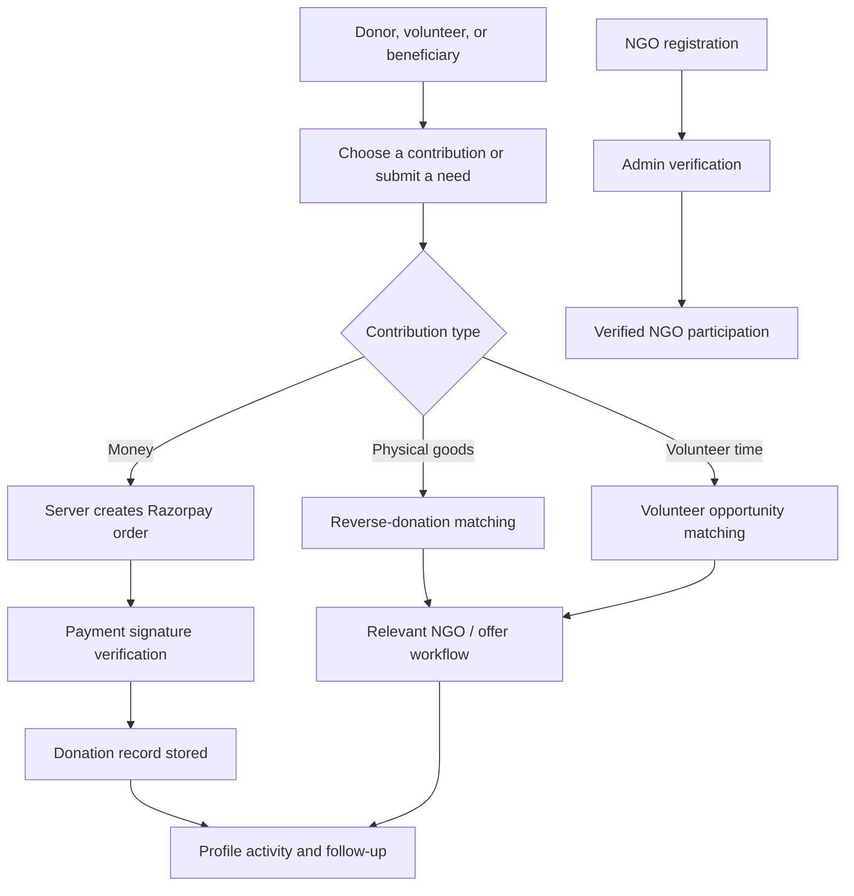
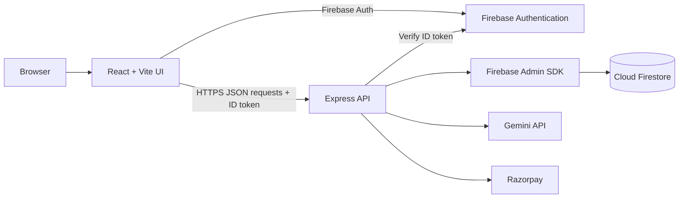

SEWA SANKALP BHARAT
A smarter way to turn generosity into meaningful action.
A verified giving platform that connects donors, volunteers, NGOs, and people in need through resource-aware matching and accountable contribution workflows.

  <a href="https://sahyog-silk.vercel.app/"><strong>Live Application</strong></a>
  &nbsp; · &nbsp;
  <a href="https://github.com/kavya-dev05/SEWA-SANKALP-BHARAT"><strong>Source Code</strong></a>

  
  
  
  
  
  

Overview
Sewa Sankalp Bharat is a social-impact platform designed to make giving more direct, relevant, and accountable. Rather than leaving donors to search through disconnected campaigns, the platform helps connect a contribution with a verified NGO or an opportunity that fits the donor's resources, interests, and availability.

People can contribute in different ways: money, physical resources, or time. NGOs can publish needs and volunteer opportunities, manage incoming offers, and build trust through an administrator-led verification process. Individuals can also submit requests for assistance.

The guiding idea is simple: connect a real need with the right contribution, then make the journey easier to follow.
The deployed interface is available at sahyog-silk.vercel.app. Feature availability depends on the configured backend services and environment variables.

Table of contents
- Why Sewa Sankalp Bharat
- Platform capabilities
- How it works
- Technology stack
- Architecture
- Getting started
- Environment configuration
- Available scripts
- API overview
- Data and access model
- Security considerations
- Project structure
- Roadmap
- Contributing
- License
Why Sewa Sankalp Bharat
Giving often involves more friction than it should. Donors may not know which organisation needs what, NGOs may struggle to discover relevant contributions, and volunteers may find it difficult to identify opportunities that suit their skills and schedules.

Sewa Sankalp Bharat addresses these gaps through a shared workflow:
- Need-led giving: match contributions to stated NGO needs instead of relying only on manual discovery.
- Multiple contribution paths: support monetary donations, physical-resource offers, and volunteering.
- Trust-oriented onboarding: route NGO registration through a verification workflow.
- AI-assisted discovery: use Gemini to rank suitable NGOs and volunteer opportunities from records supplied by the application.
- Account-aware experiences: provide donor profiles, NGO operations, notifications, and an administrative verification interface.
- Traceable activity: record contribution activity and payment references to support follow-up.
Platform capabilities
01 — Monetary donations
- Choose a contribution amount and cause.
- Create a Razorpay order through the server.
- Verify the payment signature on the backend before recording a successful payment.
- Keep donation activity associated with the signed-in user.
02 — Physical-resource donations
- Offer available goods and specify quantities.
- Find potentially relevant NGO needs through reverse-donation matching.
- Notify an NGO when a donation offer targets its organisation.
- Track offer states such as pending, accepted, or declined.
03 — Volunteer matching
- Submit skills, location, availability, and preferred causes.
- Receive AI-ranked opportunities based on the supplied opportunity records.
- Let NGOs publish roles, skill requirements, schedules, and descriptions.
- Record volunteer engagements and notify the relevant NGO.
04 — NGO onboarding and verification
- Support NGO accounts with organisation details.
- Keep verification status as part of the NGO profile.
- Provide an admin interface for reviewing pending organisations and approving or rejecting applications.
- Restrict administrative operations through server-side identity and role checks.
05 — NGO operations
- Publish resource needs with quantity and urgency.
- Publish volunteer requests.
- Review incoming physical-donation offers.
- View operational summaries such as funds received, pending offers, resources matched, volunteer engagements, and active needs.
06 — Profiles, activity, and notifications
- Maintain user profile information and account roles.
- Present donation and volunteer activity in the profile area.
- Show in-app notifications for relevant NGO activity.
- Allow beneficiary requests to be submitted and retrieved by their owner.
07 — Beneficiary assistance requests
- Submit a description of the need, category, urgency, preferred NGO, and location.
- Associate requests with the authenticated user.
- Keep request records available to the owner and authorised administrators.
08 — Impact-oriented experience
The interface explains how contributions move from a stated need to a potential match and then to a recorded outcome. Illustrative examples and counters in the interface should be treated as demonstrations unless they are explicitly connected to live, verified records.
How it works

AI matching approach
The server provides Gemini with a structured description of the contribution or volunteer profile and the relevant records retrieved from Firestore. Gemini returns a ranked list of matches in a constrained JSON response.

The intended matching signals include:
Donation matching	Volunteer matching
Resource compatibility	Skills and role fit
Location / distance	Availability
Quantity fit	Location / distance
Cause alignment	Cause alignment

The matching service is instructed to select only from the records provided by the application and to return no matches when the relevant collection is empty. The resulting scores are AI-generated rankings, not independently measured guarantees of suitability. Location and distance values should be interpreted according to the data available to the application.
Technology stack
Layer	Technology	Responsibility
Frontend	React 19, TypeScript	Component-based user interface and application state
Build tooling	Vite 6	Development server and frontend build
Styling	Tailwind CSS 4, custom CSS	Responsive layout and visual system
Navigation	React Router	Client-side page routing
Motion and icons	Motion, Lucide React	Interface transitions and iconography
Backend	Node.js, Express 4, TypeScript	API endpoints and server-side workflows
Authentication	Firebase Authentication	Email/password and Google sign-in
Database	Cloud Firestore	User profiles, donations, NGO needs, engagements, and notifications
Privileged database access	Firebase Admin SDK	Server-side Firestore operations and identity verification
AI matching	Google Gemini API (@google/genai)	Structured NGO and volunteer match ranking
Payments	Razorpay Node SDK	Order creation and payment-signature verification
Build output	esbuild	Bundles the Express server for production

Architecture
The application uses a React client and an Express API in the same project. Vite serves the client during development, while the Express server exposes /api/* endpoints and serves the built frontend in production.

Request flow
1. A user signs in through Firebase Authentication.
2. The client obtains a Firebase ID token for protected API requests.
3. Express middleware verifies the token before executing protected operations.
4. The server uses Firebase Admin SDK for privileged database work.
5. Matching requests call Gemini with application-provided records.
6. Monetary donation requests create a Razorpay order; payment completion is recorded only after server-side signature verification.
Getting started
Prerequisites
Install the following before running the project:
- Node.js (use a currently supported LTS release)
- npm
- A Firebase project with Authentication and Cloud Firestore enabled
- A Google Gemini API key
- Razorpay API keys if testing monetary donations
- A Firebase Admin service-account credential for the server
1. Clone the repository
git clone https://github.com/kavya-dev05/SEWA-SANKALP-BHARAT.git
cd SEWA-SANKALP-BHARAT
2. Install dependencies
npm install
3. Configure environment variables
Create a local .env file from the example:
cp .env.example .env
On Windows PowerShell, use:
Copy-Item .env.example .env
Fill in the required values described in Environment configuration. Place the Firebase Admin service-account JSON file at the path configured for GOOGLE_APPLICATION_CREDENTIALS, or update that variable to point to its local location.
4. Configure Firebase
1. Enable the sign-in providers used by the app in Firebase Authentication.
2. Create or select the Cloud Firestore database.
3. Configure the Firebase web-app settings in firebase-applet-config.json using your own project's configuration.
4. Review and deploy the repository's firestore.rules to the correct Firebase project.
5. Add the local and deployed application domains to Firebase Authentication's authorised domains where required.
Do not use permissive development rules in production. The application uses both client-side Firebase access and server-side Admin SDK operations; rules should reflect the intended access model.
5. Run in development
npm run dev
Open http://localhost:3000.
6. Build and run for production
npm run build
npm start
The build command compiles the frontend and bundles the Express server into dist/server.cjs. Configure your hosting platform to provide the required environment variables and Firebase credentials securely.
Environment configuration
Keep real credentials in your local environment or your hosting provider's secret manager. Never commit .env or service-account credentials.
Variable	Purpose	Required for
GEMINI_API_KEY	Authenticates requests to the Gemini API	AI matching
APP_URL	Application base URL for deployment configuration	Deployment-specific configuration
GOOGLE_APPLICATION_CREDENTIALS	Path to Firebase Admin service-account JSON	Server-side Firestore and Admin SDK
RAZORPAY_KEY_ID	Razorpay key identifier; the public checkout key is returned by the API	Monetary donations
RAZORPAY_KEY_SECRET	Server-side Razorpay secret used for payment-signature verification	Monetary donations
ADMIN_BOOTSTRAP_SECRET	Secret for the admin bootstrap endpoint	Initial admin setup

The project also reads Firebase web-app configuration from firebase-applet-config.json. That file should contain configuration for your own Firebase project. Firebase web configuration is not a substitute for securing Firestore rules, API endpoints, or server credentials.
Available scripts
Command	Description
npm run dev	Starts the development server through tsx server.ts
npm run build	Builds the frontend and bundles the Express server
npm start	Runs the production server after the build step
npm run lint	Runs the TypeScript compiler in no-emit mode
npm run preview	Starts Vite's preview server for the built frontend
npm run clean	Removes generated build output

API overview
The Express server exposes the following principal routes. Protected endpoints require a valid Firebase ID token in the Authorization: Bearer <token> header unless otherwise noted.
Endpoint	Purpose	Access
GET /api/firebase-config	Returns the Firebase web configuration	Public
GET /api/config	Returns the Razorpay public key ID	Public
POST /api/donations	Creates a physical-donation record	Authenticated
POST /api/volunteers	Records a volunteer engagement	Authenticated
POST /api/create-order	Creates a Razorpay order	Authenticated
POST /api/verify-payment	Verifies a Razorpay signature and records the payment	Authenticated
GET /api/profile/stats	Returns donor contribution statistics	Authenticated
GET /api/profile/activity	Returns recent donor activity	Authenticated
GET /api/ngo/dashboard	Returns NGO operational summaries	Authenticated
GET /api/ngo/incoming	Lists incoming physical-donation offers	Authenticated
PATCH /api/ngo/incoming/:id/accept	Accepts an incoming offer	Authenticated
PATCH /api/ngo/incoming/:id/decline	Declines an incoming offer	Authenticated
POST /api/ngo/needs	Creates an NGO resource need	Authenticated
POST /api/ngo/volunteer-request	Creates a volunteer opportunity	Authenticated
GET /api/notifications	Retrieves notifications for the current user	Authenticated
POST /api/notifications/mark-read	Marks notifications as read	Authenticated
POST /api/beneficiary/request	Submits a beneficiary request	Authenticated
GET /api/beneficiary/requests	Lists the current user's beneficiary requests	Authenticated
GET /api/admin/pending-ngos	Lists NGOs awaiting verification	Admin
POST /api/admin/verify-ngo	Approves or rejects an NGO	Admin
POST /api/admin/bootstrap	Bootstraps an administrator account	Secret-protected setup route
POST /api/match-ngos	Ranks NGO matches for a physical donation	Matching endpoint
POST /api/match-volunteers	Ranks volunteer opportunities	Matching endpoint

Implementation note: The route list describes the endpoints present in the current server source. Before production deployment, review each endpoint's authorisation and ownership checks, especially NGO offer updates and matching routes, and add rate limiting, validation, and monitoring as appropriate.
Data and access model
The Firestore collections used by the application include:
Collection	Purpose
users	Donor and NGO profiles, roles, and verification information
donations	Physical and monetary contribution records
ngos	NGO records used by matching
ngo_needs	Resource needs published by NGOs
volunteer_opportunities	Roles and opportunities published by NGOs
volunteer_engagements	Volunteer participation records
beneficiary_requests	Requests for assistance
notifications	In-app notifications directed to NGO users

The repository includes Firestore rules that define client-side access for several collections. Server code uses the Firebase Admin SDK, which bypasses Firestore Security Rules; therefore, protected Express endpoints must enforce authorisation and ownership checks themselves.
Security considerations
Before deploying or sharing a production instance:
- Protect credentials. Never commit .env, serviceAccountKey.json, or any private API secret. Use hosting secrets or a secret manager.
- Rotate exposed secrets. If a real service-account key or API secret has ever been committed or shared, revoke or rotate it. Removing a file in a later commit does not remove it from Git history.
- Review server authorisation. Verify that every NGO-specific update checks both the authenticated identity and ownership of the target record.
- Validate inputs. Validate request bodies, numeric amounts, identifiers, and allowed state transitions on the server.
- Harden payment handling. Keep the Razorpay secret server-side, verify signatures server-side, and reconcile payment state against trusted provider data.
- Apply least-privilege Firestore rules. Test rules using the Firebase Emulator Suite or a dedicated test project.
- Protect the admin bootstrap flow. Use a strong one-time secret, restrict access during initial setup, and disable or tightly gate the bootstrap endpoint afterward.
- Use HTTPS and safe deployment settings. Keep dependencies updated and review audit findings before release.
This README documents the code structure and intended flows; it is not a security certification or a claim that every production-hardening measure has been implemented.
Project structure
SEWA-SANKALP-BHARAT/
├── public/
│   └── logo.png
├── scripts/
│   ├── seed-database.ts
│   └── test-api.js
├── src/
│   ├── components/
│   │   ├── AuthModal.tsx
│   │   ├── Layout.tsx
│   │   └── Toast.tsx
│   ├── context/
│   │   └── AuthContext.tsx
│   ├── pages/
│   │   ├── Admin.tsx
│   │   ├── Donate.tsx
│   │   ├── Features.tsx
│   │   ├── Home.tsx
│   │   ├── HowItWorks.tsx
│   │   ├── Impact.tsx
│   │   ├── Matching.tsx
│   │   ├── Profile.tsx
│   │   └── Volunteer.tsx
│   ├── App.tsx
│   ├── index.css
│   └── main.tsx
├── server.ts
├── firestore.rules
├── firebase-applet-config.json
├── .env.example
├── package.json
└── vite.config.ts
Roadmap
Potential next steps for a more production-ready platform:
- Add automated tests for authentication, API authorisation, payment verification, and matching behaviour.
- Add audit logs for NGO verification and donation state transitions.
- Enforce ownership checks and valid state transitions for every NGO operation.
- Add pagination, filtering, and operational observability for larger datasets.
- Improve matching transparency with explainable match factors and data-quality indicators.
- Add end-to-end tests for donor, NGO, volunteer, and administrator journeys.
- Publish deployment instructions for the chosen hosting environment and document backup/recovery procedures.
Contributing
Contributions, bug reports, and thoughtful suggestions are welcome.
1. Fork the repository.
2. Create a focused branch: git checkout -b feat/your-change.
3. Make and test your changes.
4. Run npm run lint and npm run build.
5. Commit with a clear message and open a pull request describing the change and its motivation.
For substantial changes, open an issue first so the proposed direction can be discussed.
License
No license file was identified in the project snapshot. Unless a license is added to the repository, reuse and redistribution permissions are not explicitly granted. Add a LICENSE file if you intend to publish the project under an open-source license.

SEWA SANKALP BHARAT

Make giving more intentional. Make every contribution count.

Open the live application · Explore the repository

